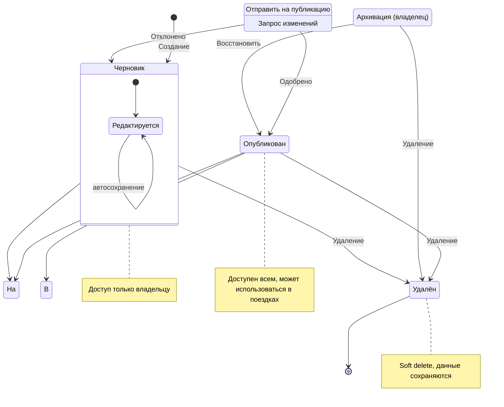
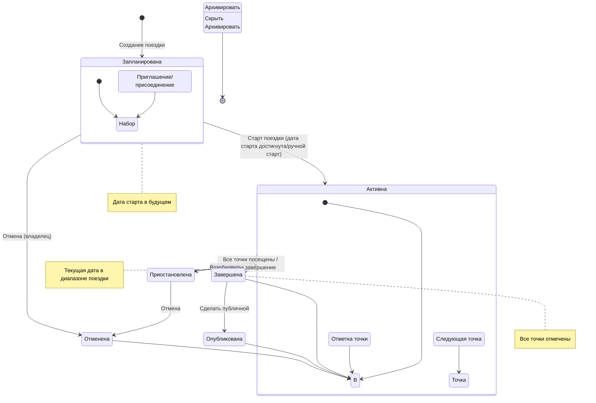
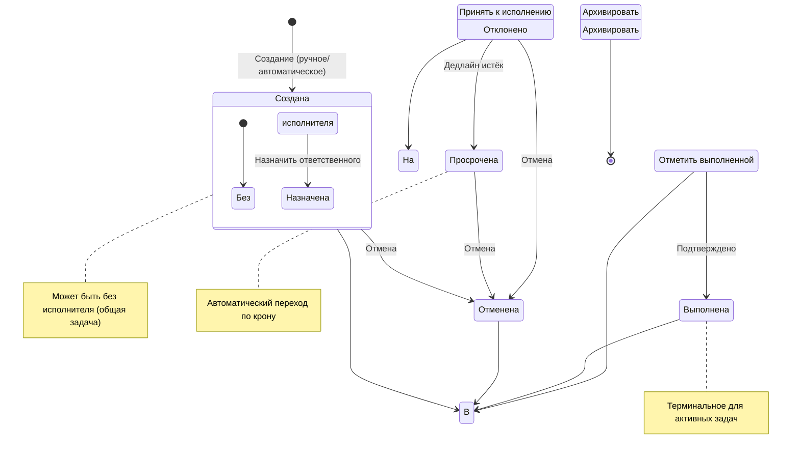
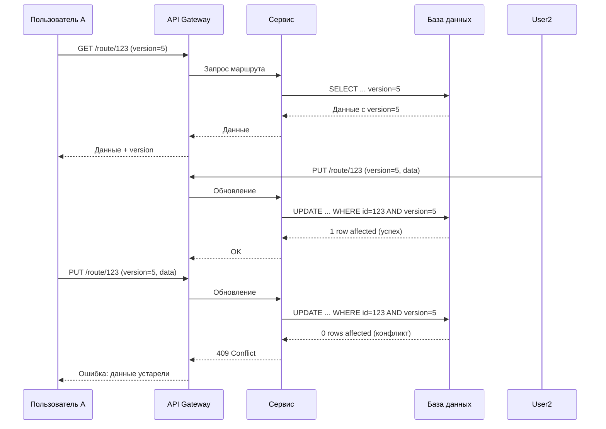

# 1. Выбор сущностей для моделирования состояний

## Выбранные сущности и обоснование

| Сущность                   | Обоснование выбора                                                                                                                       | Риски без формальной модели                                                                                                                             |
| -------------------------- | ---------------------------------------------------------------------------------------------------------------------------------------- | ------------------------------------------------------------------------------------------------------------------------------------------------------- |
| **Маршрут-шаблон (Route)** | Центральная сущность, вокруг которой строится вся экосистема. Может быть публичным/приватным, использоваться в поездках, редактироваться | • Потеря данных при одновременном редактировании • Несогласованность между владельцем и редакторами • Публикация невалидных/неполных маршрутов    |
| **Поездка (Event)**        | Сложный жизненный цикл с участниками, статусами, временными ограничениями. Требует строгой последовательности действий                   | • Участники могут присоединиться к уже завершённой поездке • Конфликты при параллельном изменении дат • Потеря истории действий участников        |
| **Задача (Task)**          | Привязана к поездке, имеет назначенных исполнителей и дедлайны. Критична для группового взаимодействия                                   | • Задачи могут быть закрыты без фактического выполнения • Потеря ответственности при смене статуса поездки • Невозможность восстановления истории |

## Статусы из прецедентов и уточнения

**Из существующих сценариев:**
- Маршрут: `public`/`private`, `active`/`deleted`
- Поездка: `planned`, `active`, `completed`, `cancelled`
- Задача: `pending`, `done`, `cancelled`

**Требуемые уточнения:**
- Добавить промежуточные статусы (`draft`, `archived`)
- Уточнить терминальные состояния
- Определить возвратные и невозвратные переходы

# 2. Полный набор состояний

## Маршрут-шаблон (Route)

| Состояние | Тип | Смысл | Возврат назад? |
|-----------|-----|-------|----------------|
| Черновик | Промежуточное | Маршрут создаётся/редактируется, не виден другим | Н/Д |
| На модерации | Промежуточное | Ожидает проверки модератором | Да (в черновик) |
| Опубликован | Основное | Доступен всем пользователям, может использоваться | Да (в архив/модерацию) |
| В архиве | Промежуточное | Скрыт из общего доступа, но не удалён | Да (восстановление) |
| Удалён | Терминальное | Помечен как удалённый, не отображается | Нет |

## Поездка (Event)

| Состояние | Тип | Смысл | Возврат назад? |
|-----------|-----|-------|----------------|
| Запланирована | Промежуточное | Поездка создана, дата в будущем, идёт набор участников | Н/Д |
| Активна | Основное | Поездка происходит сейчас, участники отмечают точки | Да (на паузу) |
| Приостановлена | Исключительное | Поездка временно остановлена | Да (возобновить) |
| Завершена | Основное | Все точки посещены, поездка окончена | Нет |
| Опубликована | Основное | Завершённая поездка доступна для просмотра | Да (в архив) |
| Отменена | Терминальное | Поездка отменена до или во время | Да (в архив) |
| В архиве | Терминальное | Архивированная поездка | Нет |

## Задача (Task)

| Состояние | Тип | Смысл | Возврат назад? |
|-----------|-----|-------|----------------|
| Создана | Промежуточное | Задача появилась, может быть без исполнителя | Н/Д |
| В работе | Основное | Исполнитель приступил | Да (на создана) |
| На проверке | Промежуточное | Ожидает подтверждения выполнения | Да (в работу) |
| Просрочена | Исключительное | Дедлайн истёк, задача не выполнена | Да (в работу) |
| Выполнена | Терминальное | Успешно завершена | Нет |
| Отменена | Терминальное | Отменена (не будет выполнена) | Нет |
| В архиве | Терминальное | Архивирована | Нет |

# 3. События и источники событий

## Общие события

| Событие | Описание | Инициатор | Роль | Тип |
|---------|----------|-----------|------|-----|
| Создать | Создание новой сущности | Пользователь | Все | Ручное |
| Редактировать | Изменение полей | Пользователь | Владелец/Админ | Ручное |
| Удалить | Помечание как удалённое | Пользователь | Владелец/Админ | Ручное |
| Восстановить | Восстановление из удалённых | Пользователь | Владелец/Админ | Ручное |

## События для Маршрута

| Событие | Описание | Инициатор | Роль | Тип |
|---------|----------|-----------|------|-----|
| Отправить на модерацию | Запрос публикации | Пользователь | Владелец | Ручное |
| Одобрить | Публикация маршрута | Модератор | Админ | Ручное |
| Отклонить | Отказ в публикации | Модератор | Админ | Ручное |
| Архивировать | Перемещение в архив | Пользователь | Владелец | Ручное |
| Запросить изменения | Требование доработки | Модератор | Админ | Ручное |

## События для Поездки

| Событие | Описание | Инициатор | Роль | Тип |
|---------|----------|-----------|------|-----|
| Пригласить | Отправка приглашения | Пользователь | Организатор | Ручное |
| Присоединиться | Запрос на участие | Пользователь | Любой | Ручное |
| Принять участника | Подтверждение участия | Пользователь | Организатор | Ручное |
| Отклонить участника | Отказ в участии | Пользователь | Организатор | Ручное |
| Покинуть поездку | Выход из поездки | Пользователь | Участник | Ручное |
| Стартовать | Начать поездку | Система | Система | Авто (по дате) |
| Отметить точку | Зафиксировать посещение | Пользователь | Участник | Ручное |
| Завершить | Завершить поездку | Пользователь | Организатор | Ручное |
| Приостановить | Временная остановка | Пользователь | Организатор | Ручное |
| Возобновить | Продолжение поездки | Пользователь | Организатор | Ручное |
| Отменить | Отмена поездки | Пользователь | Организатор | Ручное |

## События для Задачи

| Событие | Описание | Инициатор | Роль | Тип |
|---------|----------|-----------|------|-----|
| Назначить | Назначение исполнителя | Пользователь | Организатор/Автор | Ручное |
| Принять | Взять в работу | Пользователь | Исполнитель | Ручное |
| Выполнить | Отметка о выполнении | Пользователь | Исполнитель | Ручное |
| Подтвердить | Подтверждение выполнения | Пользователь | Организатор/Автор | Ручное |
| Отклонить выполнение | Отказ в подтверждении | Пользователь | Организатор/Автор | Ручное |
| Просрочить | Автоматическая просрочка | Система | Система | Авто (крон) |

# 4. Диаграммы состояний

*(Представлены выше в п.2)*

# 5. Инварианты и обязательные данные по состояниям

## Маршрут-шаблон

| Состояние | Обязательные поля | Запрещённые поля | Инварианты |
|-----------|-------------------|------------------|------------|
| Черновик | title | - | title может быть пустым? (нет, должен быть) |
| На модерации | title, description, waypoints (мин.1), tags (мин.1) | - | Все точки должны иметь длительность >0 |
| Опубликован | title, description, waypoints, tags | - | Должен иметь хотя бы 1 лайк? (нет) |
| В архиве | - | - | Не должен использоваться в новых поездках |
| Удалён | - | - | Не должен отображаться в UI |

## Поездка

| Состояние | Обязательные поля | Запрещённые поля | Инварианты |
|-----------|-------------------|------------------|------------|
| Запланирована | routeId, startDate, title | actual_start, actual_end | startDate > текущей даты |
| Активна | routeId, startDate | - | Текущая дата между startDate и endDate |
| Приостановлена | reason | - | Должна быть причина приостановки |
| Завершена | endDate | - | Все точки должны иметь actual_end |
| Опубликована | endDate | - | Должна быть завершена |
| Отменена | cancel_reason | - | Должна быть причина отмены |
| В архиве | - | - | Не отображается в активных списках |

## Задача

| Состояние | Обязательные поля | Запрещённые поля | Инварианты |
|-----------|-------------------|------------------|------------|
| Создана | title, eventId | completed_at | - |
| В работе | assigned_to | completed_at | assigned_to должен быть участником поездки |
| На проверке | assigned_to | - | Должно быть описание выполнения |
| Просрочена | assigned_to, due_date | completed_at | due_date < now() |
| Выполнена | completed_at | - | completed_at >= created_at |
| Отменена | cancel_reason | - | - |
| В архиве | - | - | Не отображается в активных |

# 6. Правила прав доступа и аудит переходов

## Матрица доступа

| Переход | Разрешённые роли | Аудит | Доп. условия |
|---------|------------------|-------|--------------|
| **Маршрут** | | | |
| Создать | Все авторизованные | Да (создание) | - |
| Редактировать черновик | Владелец | Нет | - |
| Отправить на модерацию | Владелец | Да (запрос) | Минимум 1 точка |
| Одобрить | Админ, Модератор | Да (решение) | - |
| Отклонить | Админ, Модератор | Да (причина) | Должен указать причину |
| Удалить | Владелец, Админ | Да (удаление) | Подтверждение |
| **Поездка** | | | |
| Создать | Все авторизованные | Да | Действительный routeId |
| Пригласить | Организатор | Да | Email должен быть валидным |
| Присоединиться | Все авторизованные | Да | Только для групповых |
| Принять участника | Организатор | Да | Статус участника pending |
| Отметить точку | Участник | Да | Поездка активна |
| Завершить | Организатор | Да | Все точки посещены |
| **Задача** | | | |
| Создать | Организатор, Автор | Да | Привязана к событию |
| Назначить | Организатор, Автор | Да | Участник события |
| Принять | Исполнитель | Да | - |
| Подтвердить | Организатор, Автор | Да | Статус "на проверке" |

# 7. Таблица переходов как спецификация

## Маршрут (фрагмент)

| Текущее состояние | Событие | Новое состояние | Условия | Обязательные данные | Код ошибки |
|-------------------|---------|-----------------|---------|---------------------|------------|
| Черновик | Отправить на модерацию | На модерации | waypoints.length > 0, title != '' | - | ROUTE_001 |
| На модерации | Одобрить | Опубликован | - | moderator_comment | ROUTE_002 |
| На модерации | Отклонить | Черновик | - | rejection_reason | - |
| Опубликован | Архивировать | В архиве | - | - | - |
| * | Удалить | Удалён | - | - | - |
| Опубликован | Редактировать | Черновик | - | - | ROUTE_003 |

## Поездка (фрагмент)

| Текущее состояние | Событие | Новое состояние | Условия | Обязательные данные | Код ошибки |
|-------------------|---------|-----------------|---------|---------------------|------------|
| Запланирована | Присоединиться | Запланирована | is_group = true | - | EVENT_001 |
| Запланирована | Стартовать | Активна | startDate <= now() | - | EVENT_002 |
| Активна | Отметить точку | Активна | waypoint не отмечен ранее | actual_time | EVENT_003 |
| Активна | Завершить | Завершена | все точки отмечены | - | EVENT_004 |
| Активна | Приостановить | Приостановлена | - | pause_reason | - |
| * | Отменить | Отменена | - | cancel_reason | - |

# 8. Конфликты параллельных изменений

## Сценарии конфликтов

1. **Два модератора одновременно одобряют/отклоняют маршрут**
2. **Организатор меняет дату поездки, пока участник присоединяется**
3. **Исполнитель завершает задачу, а организатор её удаляет**

## Механизм предотвращения

**Алгоритм:**
- Каждая запись имеет поле `version` (integer)
- При обновлении проверяем `WHERE id = ? AND version = ?`
- Если затронуто 0 строк → конфликт
- Возвращаем 409 Conflict с информацией о конфликте

# 9. Набор тест-кейсов (15+)

## Маршрут

| № | Название | Начальное состояние | Событие | Входные данные | Ожидаемое состояние | Ожидаемая ошибка |
|---|----------|---------------------|---------|----------------|---------------------|------------------|
| 1 | Создание черновика | - | Создать | title="Мой маршрут" | Черновик | - |
| 2 | Отправка на модерацию без точек | Черновик | Отправить на модерацию | - | Черновик | ROUTE_001 |
| 3 | Успешная отправка | Черновик | Отправить на модерацию | waypoints=[...] | На модерации | - |
| 4 | Одобрение маршрута | На модерации | Одобрить | moderator_comment="ОК" | Опубликован | - |
| 5 | Отклонение маршрута | На модерации | Отклонить | rejection_reason="Плохо" | Черновик | - |
| 6 | Удаление опубликованного | Опубликован | Удалить | - | Удалён | - |
| 7 | Редактирование опубликованного | Опубликован | Редактировать | - | Черновик | - |

## Поездка

| № | Название | Начальное состояние | Событие | Входные данные | Ожидаемое состояние | Ожидаемая ошибка |
|---|----------|---------------------|---------|----------------|---------------------|------------------|
| 8 | Создание поездки | - | Создать | routeId=123, startDate=завтра | Запланирована | - |
| 9 | Присоединение к негрупповой | Запланирована | Присоединиться | - | Запланирована | EVENT_001 |
| 10 | Автоматический старт | Запланирована | Стартовать (крон) | - | Активна | - |
| 11 | Отметка точки неучастником | Активна | Отметить точку | - | Активна | 403 Forbidden |
| 12 | Завершение без всех точек | Активна | Завершить | - | Активна | EVENT_004 |
| 13 | Успешное завершение | Активна | Завершить | все точки отмечены | Завершена | - |

## Задача

| № | Название | Начальное состояние | Событие | Входные данные | Ожидаемое состояние | Ожидаемая ошибка |
|---|----------|---------------------|---------|----------------|---------------------|------------------|
| 14 | Назначение исполнителя | Создана | Назначить | assigned_to=user123 | Создана | - |
| 15 | Принятие задачи | Создана | Принять | - | В работе | - |
| 16 | Выполнение задачи | В работе | Выполнить | comment="Готово" | На проверке | - |
| 17 | Подтверждение выполнения | На проверке | Подтвердить | - | Выполнена | - |
| 18 | Отклонение выполнения | На проверке | Отклонить выполнение | reason="Плохо" | В работе | - |
| 19 | Просрочка задачи | В работе | Просрочить (крон) | due_date < now | Просрочена | - |
| 20 | Отмена задачи | В работе | Отменить | reason="Не нужно" | Отменена | - |

# 10. Пакет результатов

## Состав комплекта

1. **Диаграммы состояний** (3 шт.) — визуальное представление жизненных циклов
2. **Таблицы переходов** (3 шт.) — формальная спецификация для разработчиков
3. **Перечень событий** — полный список с инициаторами и ролями
4. **Матрица прав доступа** — кто что может делать
5. **Тест-кейсы** (20 шт.) — покрытие основных и альтернативных сценариев
6. **Спецификация инвариантов** — правила целостности данных

## Использование при реализации

- **Разработка:** Таблицы переходов используются как источник требований для реализации конечных автоматов
- **Валидация:** Инварианты проверяются на уровне домена (бизнес-логика) и БД (constraints)
- **Аудит:** Все переходы, помеченные как "Аудит", записываются в отдельную таблицу с метаданными
- **Тестирование:** Тест-кейсы покрывают 100% разрешённых и запрещённых переходов

## Использование при расследовании инцидентов

- Логи аудита позволяют восстановить историю изменений сущности
- Таблица переходов помогает определить, был ли переход допустим в конкретном состоянии
- При конфликтах версий система возвращает пользователю понятное сообщение
