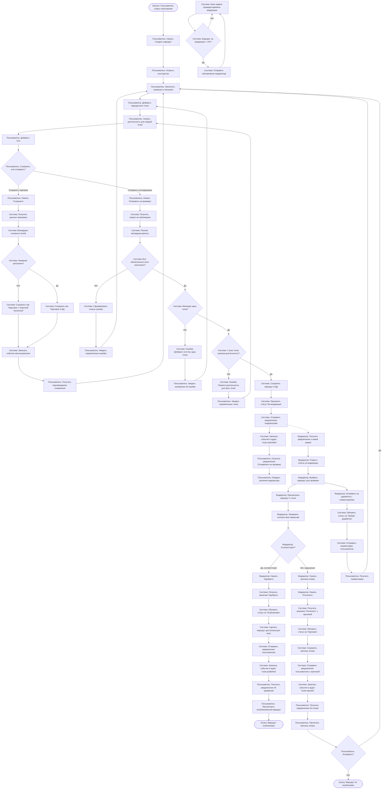
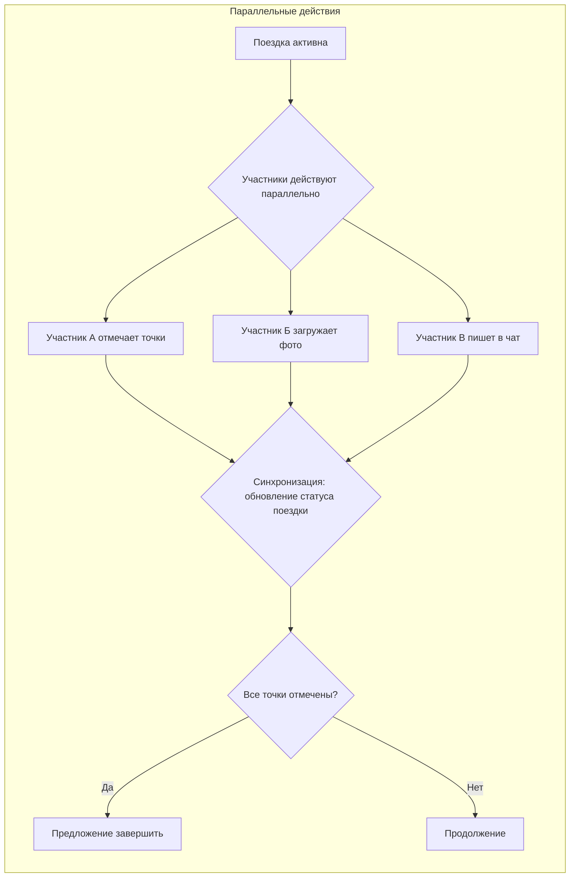

 

## 1. Выбор процессов для моделирования

### Процесс 1: **Создание и публикация маршрута-шаблона**
- **Границы процесса:** Начало — пользователь открывает конструктор, конец — маршрут опубликован в общем доступе или сохранён как черновик
- **Критерий успешного завершения:** Маршрут имеет статус "Опубликован" и доступен другим пользователям
- **Бизнес-результаты:** 
  - Увеличение базы публичных маршрутов
  - Вовлечённость пользователей (UGC)
  - Качество контента (модерация)

### Процесс 2: **Организация и проведение групповой поездки**
- **Границы процесса:** Начало — выбор маршрута и создание поездки, конец — поездка завершена и опубликован фотоотчёт
- **Критерий успешного завершения:** Все точки маршрута посещены, участники поделились медиа, поездка завершена
- **Бизнес-результаты:**
  - Удержание пользователей
  - Социальное взаимодействие
  - Генерация пользовательского контента (фото, отзывы)

## 2. Определение ролей и дорожек ответственности

| Роль | Описание | Тип |
|------|----------|-----|
| **Пользователь (User)** | Авторизованный пользователь, создающий маршруты и участвующий в поездках | Человек |
| **Модератор (Moderator)** | Проверяет публикуемые маршруты на соответствие правилам | Человек |
| **Система (System)** | Автоматические действия: валидация, уведомления, расчёты, крон-задачи | Автомат |
| **Организатор (Organizer)** | Пользователь, создавший поездку (частный случай роли User) | Человек |
| **Участник (Participant)** | Пользователь, присоединившийся к поездке (частный случай роли User) | Человек |

## 3. Процесс 1: Создание и публикация маршрута-шаблона

```mermaid
flowchart TD
    %% Процесс 2: Организация групповой поездки
    
    %% Начало процесса
    Start([Начало: Пользователь выбрал маршрут]) --> O1[Организатор: Заполнить параметры поездки]
    
    %% Дорожка Организатора
    O1 --> O2[Организатор: Указать дату старта]
    O2 --> O3[Организатор: Включить режим групповой]
    O3 --> O4[Организатор: Ввести email'ы приглашённых]
    O4 --> O5[Организатор: Нажать 'Создать поездку']
    O5 --> S1
    
    %% Дорожка Системы - Создание
    S1[Система: Валидация даты] --> S2{Система: Дата в будущем?}
    S2 -->|Нет| S3[Система: Вернуть ошибку]
    S3 --> O2
    
    S2 -->|Да| S4[Система: Создать поездку в БД]
    S4 --> S5[Система: Присвоить статус 'Запланирована']
    S5 --> S6[Система: Для каждого email проверить регистрацию]
    
    S6 --> S7{Система: Пользователь существует?}
    S7 -->|Да| S8[Система: Создать приглашение со статусом 'pending']
    S7 -->|Нет| S9[Система: Сохранить email для будущей регистрации]
    
    S8 --> S10[Система: Отправить email-приглашение]
    S9 --> S10
    S10 --> S11[Система: Записать событие в аудит]
    S11 --> P1
    
    %% Дорожка Участника - Получение приглашения
    P1[Участник: Получить email-приглашение] --> P2{Участник: Принять?}
    P2 -->|Нет| P3[Участник: Игнорировать]
    P3 --> End1([Конец: Не участвует])
    
    P2 -->|Да| P4[Участник: Перейти по ссылке]
    P4 --> P5[Участник: Нажать 'Подтвердить участие']
    P5 --> S12
    
    %% Дорожка Системы - Обработка подтверждения
    S12[Система: Получить запрос на подтверждение] --> S13{Система: Поездка в статусе 'Запланирована'?}
    S13 -->|Нет| S14[Система: Вернуть ошибку 'Набор закрыт']
    S14 --> P6[Участник: Увидеть сообщение об ошибке]
    P6 --> End2([Конец: Отказ])
    
    S13 -->|Да| S15[Система: Обновить статус участника на 'accepted']
    S15 --> S16[Система: Отправить уведомление организатору]
    S16 --> S17[Система: Добавить участника в чат поездки]
    S17 --> S18[Система: Записать событие в аудит]
    S18 --> O6
    
    %% Дорожка Организатора - Обработка заявок
    O6[Организатор: Получить уведомление о новой заявке] --> O7[Организатор: Открыть список заявок]
    O7 --> O8{Организатор: Решение?}
    O8 -->|Принять| O9[Организатор: Нажать 'Принять']
    O8 -->|Отклонить| O10[Организатор: Нажать 'Отклонить']
    
    O9 --> S19
    O10 --> S20
    
    S19[Система: Подтвердить статус 'accepted'] --> S21[Система: Уведомить участника]
    S20[Система: Обновить статус на 'declined'] --> S22[Система: Уведомить участника об отказе]
    
    S21 --> S18
    S22 --> S18
    
    %% Параллельный процесс - Автоматический старт поездки
    S23[Система: Крон-задача проверки запланированных поездок] --> S24{Система: startDate <= today?}
    S24 -->|Нет| S23
    S24 -->|Да| S25[Система: Обновить статус на 'Активна']
    S25 --> S26[Система: Отправить уведомления всем участникам]
    S26 --> S27[Система: Записать событие в аудит]
    S27 --> O11
    S27 --> P7
    
    %% Дорожка Организатора - Активная фаза
    O11[Организатор: Получить уведомление о старте] --> O12[Организатор: Отслеживать прогресс]
    O12 --> O13[Организатор: При необходимости нажать 'Приостановить']
    O13 --> S28
    
    S28[Система: Обновить статус на 'Приостановлена'] --> S29[Система: Уведомить участников]
    S29 --> O14[Организатор: Нажать 'Возобновить']
    O14 --> S30[Система: Вернуть статус 'Активна']
    
    %% Дорожка Участника - Активная фаза
    P7[Участник: Получить уведомление о старте] --> P8[Участник: Открыть страницу поездки]
    P8 --> P9[Участник: Прибыть в точку маршрута]
    P9 --> P10[Участник: Нажать 'Я здесь' у точки]
    P10 --> S31
    
    %% Дорожка Системы - Отметка точек
    S31[Система: Получить отметку точки] --> S32{Система: Точка не отмечена ранее?}
    S32 -->|Нет| S33[Система: Вернуть ошибку 'Уже посещена']
    S33 --> P10
    
    S32 -->|Да| S34[Система: Записать actual_time = now]
    S34 --> S35[Система: Обновить статус точки на 'visited']
    S35 --> S36[Система: Отправить уведомление в чат]
    S36 --> S37[Система: Проверить, все ли точки отмечены]
    
    S37 -->|Не все| P8
    S37 -->|Все| S38[Система: Отправить предложение завершить поездку]
    S38 --> O15
    
    %% Дорожка Организатора - Завершение
    O15[Организатор: Получить предложение завершить] --> O16{Организатор: Все точки действительно посещены?}
    O16 -->|Нет| O17[Организатор: Напомнить участникам]
    O17 --> P8
    
    O16 -->|Да| O18[Организатор: Нажать 'Завершить поездку']
    O18 --> S39
    
    %% Дорожка Системы - Финальные действия
    S39[Система: Получить запрос завершения] --> S40{Система: Все точки имеют статус 'visited'?}
    S40 -->|Нет| S41[Система: Показать предупреждение]
    S41 --> O18
    
    S40 -->|Да| S42[Система: Обновить статус поездки на 'Завершена']
    S42 --> S43[Система: Создать фотоотчёт из загруженных медиа]
    S43 --> S44[Система: Отправить уведомления всем участникам]
    S44 --> S45[Система: Записать событие в аудит]
    S45 --> O19
    S45 --> P11
    
    %% Дорожка Участника - Пост-обработка
    P11[Участник: Получить уведомление о завершении] --> P12[Участник: Просмотреть фотоотчёт]
    P12 --> P13[Участник: Оставить комментарии и оценки]
    P13 --> End3([Конец: Поездка завершена])
    
    O19[Организатор: Получить уведомление о завершении] --> O20[Организатор: Опубликовать поездку]
    O20 --> End3
```

### Ветвления и исключения

| Условие                        | Ветка        | Действие                                          |
| ------------------------------ | ------------ | ------------------------------------------------- |
| Данные формы невалидны         | Исключение   | Подсветка ошибок, возврат к редактированию        |
| Модератор отклонил             | Альтернатива | Возврат в черновик с указанием причины            |
| Пользователь сохранил черновик | Альтернатива | Сохранение в localStorage, не отправка модератору |
| Модератор не отвечает > 24ч    | Исключение   | Напоминание модератору (крон)                     |

## 4. Процесс 2: Организация и проведение групповой поездки

### Параллельные ветви и синхронизация

**Риски гонок и их предотвращение:**

| Риск | Последствие | Предотвращение |
|------|-------------|----------------|
| Два участника одновременно отмечают последнюю точку | Дублированное завершение поездки | Транзакционная блокировка при обновлении статуса |
| Организатор удаляет поездку во время загрузки фото | Потеря данных | Проверка статуса перед сохранением + каскадное удаление |
| Конфликт версий при параллельном редактировании | Потеря изменений | Optimistic locking с version-полем |

## 5. Данные на шагах процесса

### Процесс 1: Создание маршрута

| Шаг | Входные данные | Выходные данные | Создание/Изменение | Обязательные поля |
|-----|----------------|-----------------|-------------------|-------------------|
| Открыть конструктор | - | Форма маршрута | - | - |
| Заполнить информацию | title, description, country, image | Объект маршрута (черновик) | Создание | title (мин. 3 символа) |
| Добавить точки | city, lat, lng, duration_days, duration_hours | Массив waypoints | Создание | city, хотя бы одна длительность >0 |
| Отправить на модерацию | Объект маршрута | Статус "На модерации" | Изменение status | Все поля маршрута, минимум 1 точка |
| Одобрить/Отклонить | route_id, decision, reason | Новый статус | Изменение status | reason при отказе |

### Процесс 2: Групповая поездка

| Шаг | Входные данные | Выходные данные | Создание/Изменение | Обязательные поля |
|-----|----------------|-----------------|-------------------|-------------------|
| Выбрать маршрут | route_id | Объект маршрута | - | - |
| Создать поездку | route_id, startDate, isGroup, invitedEmails | Объект поездки (статус "planned") | Создание | startDate > now |
| Присоединиться | event_id, user_id | Статус участника "accepted" | Изменение | - |
| Отметить точку | event_id, waypoint_id | actual_time, статус "visited" | Изменение | actual_time |
| Загрузить фото | event_id, waypoint_id, file | media_id, thumbnail_url | Создание | file (jpg/png, <10MB) |
| Завершить поездку | event_id | Статус "completed" | Изменение | - |

## 6. Связь с прецедентами и функциями системы

| Шаг процесса | Прецедент (Use Case) | Функция системы | Права доступа | Аудит |
|--------------|----------------------|-----------------|---------------|-------|
| Создание маршрута | UC-1: Создать маршрут | RouteService.Create | User | Да |
| Отправка на модерацию | UC-2: Опубликовать маршрут | RouteService.SubmitForModeration | User | Да |
| Модерация маршрута | UC-3: Модерировать контент | ModerationService.Review | Moderator | Да |
| Создание поездки | UC-4: Запланировать поездку | EventService.Create | User | Да |
| Приглашение участников | UC-5: Пригласить в поездку | EventService.Invite | Organizer | Да |
| Присоединение к поездке | UC-6: Присоединиться к поездке | EventService.Join | User | Да |
| Отметка точки | UC-7: Отметить посещение | EventService.VisitWaypoint | Participant | Да |
| Загрузка фото | UC-8: Загрузить медиа | MediaService.Upload | Participant | Да |
| Завершение поездки | UC-9: Завершить поездку | EventService.Complete | Organizer | Да |

## 7. Метрики процесса и точки контроля

### Процесс 1: Публикация маршрута

| Метрика | Точка измерения | Способ сбора | Порог проблемы |
|---------|-----------------|--------------|----------------|
| Время от создания до публикации | Статус "Опубликован" - статус "Создан" | Аудит событий | > 48 часов |
| Процент отклонённых маршрутов | Статус "Отклонён" / Все отправленные | Аналитика | > 30% |
| Среднее время модерации | Время между "На модерации" и решением | Аудит | > 24 часа |
| Количество правок до публикации | Счётчик версий черновика | Журнал версий | > 3 |

### Процесс 2: Групповая поездка

| Метрика | Точка измерения | Способ сбора | Порог проблемы |
|---------|-----------------|--------------|----------------|
| Конверсия приглашений | Принявшие / Приглашённые | Статистика событий | < 50% |
| Время заполнения участников | Старт поездки - дата создания | Аудит | < 2 дней (слишком быстро) |
| Процент отмен | Отменённые / Все созданные | Аналитика | > 20% |
| Активность участников | Загружено фото / количество участников | Статистика | < 1 фото на участника |
| Соблюдение сроков | Фактическая длительность / плановая | Расчёт | > 120% |

## 8. Регламент процесса на основе диаграмм

### Регламент процесса "Публикация маршрута"

**1. Общие положения**
- Настоящий регламент определяет порядок создания и публикации маршрутов в системе Trip Builder
- Ответственные роли: Пользователь, Модератор, Система
- Сроки: модерация осуществляется в течение 24 часов с момента поступления заявки

**2. Порядок действий**

| № | Шаг | Роль | Действие | Срок | Доказательство выполнения |
|---|-----|------|----------|------|--------------------------|
| 2.1 | Создание черновика | Пользователь | Заполнить форму маршрута в конструкторе | Не ограничен | Запись в localStorage/БД со статусом "draft" |
| 2.2 | Отправка на модерацию | Пользователь | Нажать кнопку "Отправить на проверку" | После заполнения | Изменение статуса на "moderation" |
| 2.3 | Валидация | Система | Проверить заполнение обязательных полей | Мгновенно | Протокол валидации |
| 2.4 | Уведомление модератора | Система | Отправить уведомление в очередь модераторов | 1 минута | Запись в лог уведомлений |
| 2.5 | Проверка контента | Модератор | Оценить соответствие правилам | 24 часа | Решение в интерфейсе модерации |
| 2.6 | Принятие решения | Модератор | Выбрать "Одобрить" или "Отклонить" | В рамках шага 2.5 | Запись в аудит |
| 2.7 | Уведомление пользователя | Система | Отправить результат на email и in-app | 1 минута | Запись в лог уведомлений |

**3. Действия при сбоях**

| Сбой | Действие | Ответственный |
|------|----------|---------------|
| Нет ответа от модератора >24ч | Эскалация старшему модератору | Система (крон) |
| Сбой БД при сохранении | Повторная попытка через 5 сек, затем ошибка пользователю | Система |
| Потеря данных черновика | Восстановление из локального хранилища | Пользователь |

## 9. Тест-кейсы по процессам

### Процесс 1: Публикация маршрута

| № | Название | Начальные условия | Шаги | Ожидаемый результат |
|---|----------|-------------------|------|---------------------|
| TC1 | Успешная публикация | Пользователь авторизован, все поля заполнены | 1. Создать маршрут 2. Отправить на модерацию 3. Модератор одобряет | Статус "published", уведомление пользователю |
| TC2 | Отправка без названия | Пользователь авторизован, title пуст | 1. Заполнить остальные поля 2. Отправить на модерацию | Ошибка валидации, подсветка поля title |
| TC3 | Отправка без точек | Пользователь авторизован, waypoints пуст | 1. Заполнить title 2. Отправить на модерацию | Ошибка "минимум 1 точка" |
| TC4 | Отклонение маршрута | Маршрут на модерации | 1. Модератор нажимает "Отклонить" 2. Указывает причину | Статус "draft", уведомление с причиной |
| TC5 | Модерация неавторизованным | Неавторизованный пользователь пытается открыть панель модерации | 1. Перейти по URL /moderate | 401 Unauthorized, редирект на логин |
| TC6 | Публикация чужим модератором | Модератор без прав на этот тип контента | 1. Попытаться одобрить | 403 Forbidden |

### Процесс 2: Групповая поездка

| № | Название | Начальные условия | Шаги | Ожидаемый результат |
|---|----------|-------------------|------|---------------------|
| TC7 | Создание групповой поездки | Пользователь авторизован, выбран маршрут | 1. Указать дату старта (будущее) 2. Включить "групповая" 3. Ввести email друга 4. Создать | Поездка создана, другу отправлено приглашение |
| TC8 | Создание с прошедшей датой | Пользователь авторизован | 1. Указать дату старта вчера | Ошибка "дата должна быть в будущем" |
| TC9 | Присоединение к поездке | Пользователь получил приглашение | 1. Перейти по ссылке 2. Подтвердить участие | Статус участника "accepted", уведомление организатору |
| TC10 | Присоединение к завершённой поездке | Поездка уже завершена | 1. Попытаться присоединиться | Ошибка "набор участников закрыт" |
| TC11 | Отметка точки | Поездка активна, точка не отмечена | 1. Нажать "Я здесь" у точки | Статус точки "visited", actual_time записан |
| TC12 | Повторная отметка той же точки | Точка уже отмечена | 1. Снова нажать "Я здесь" | Ошибка "точка уже посещена" |
| TC13 | Завершение поездки неорганизатором | Участник пытается завершить | 1. Нажать "Завершить поездку" | 403 Forbidden |
| TC14 | Успешное завершение | Организатор, все точки отмечены | 1. Нажать "Завершить" | Статус "completed", создан фотоотчёт |
| TC15 | Завершение без всех точек | Организатор, не все точки отмечены | 1. Нажать "Завершить" | Предупреждение, запрос подтверждения |
| TC16 | Конфликт при отметке последней точки | Два участника одновременно отмечают последнюю точку | 1. Оба нажимают одновременно | Только один успех, второй получает уведомление о конфликте |

### Минимальный регрессионный набор

При изменениях процесса выполнять тесты:
- **TC1, TC4, TC7, TC9, TC11, TC14** — основной функционал
- **TC2, TC8, TC12** — ключевые валидации
- **TC16** — параллельные конфликты

---

## 10. Пакет результатов

### Состав комплекта

1. **Диаграммы деятельности** (2 шт.) — визуализация процессов с дорожками
2. **Регламенты процессов** (2 шт.) — текстовое описание порядка действий
3. **Таблицы входных/выходных данных** — спецификация для разработки
4. **Матрица метрик** — KPI для оценки эффективности
5. **Тест-кейсы** (16 шт.) — покрытие основного потока и исключений
6. **Связь с прецедентами** — трассировка требований

### Использование комплекта

| Этап | Назначение |
|------|------------|
| **Разработка** | Реализация бизнес-логики в соответствии с регламентом |
| **UI/UX проектирование** | Определение последовательности экранов и действий |
| **Тестирование** | Проверка соответствия процессов спецификации |
| **Обучение пользователей** | Документация для обучения модераторов и организаторов |
| **Аналитика** | Сбор метрик для оптимизации процессов |

