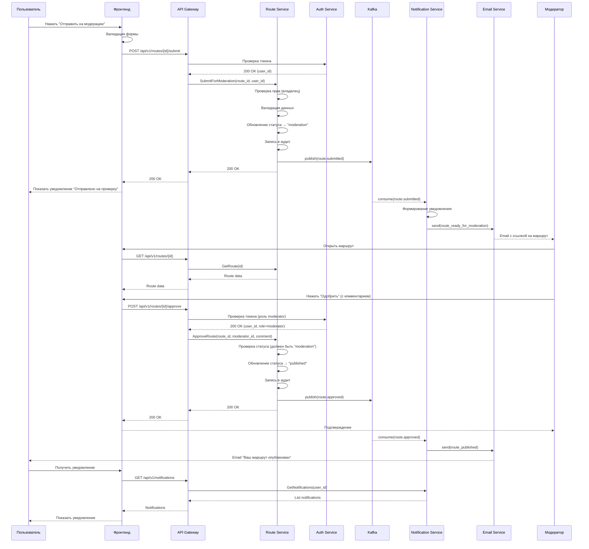
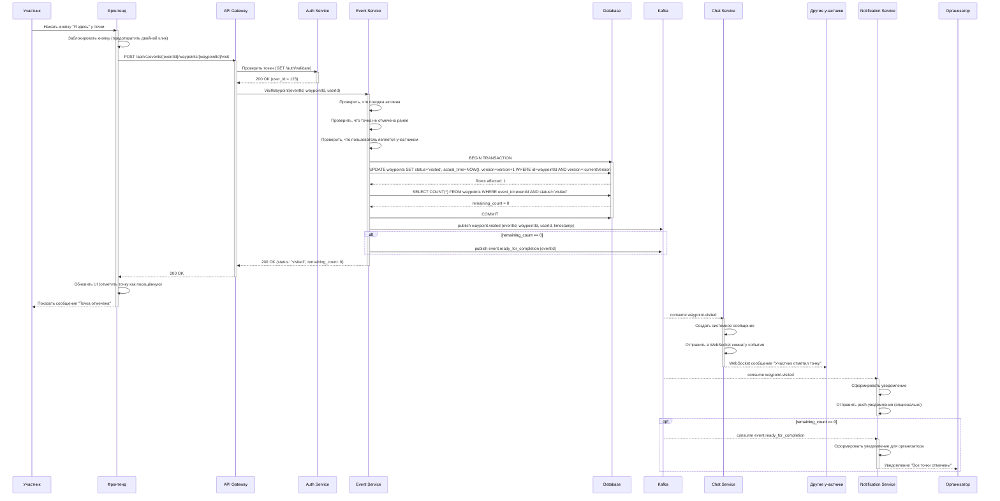
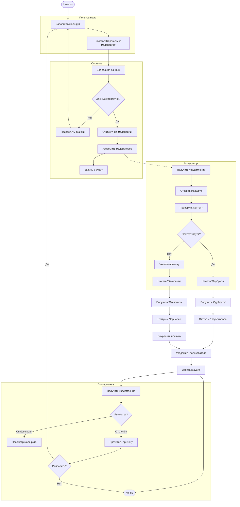
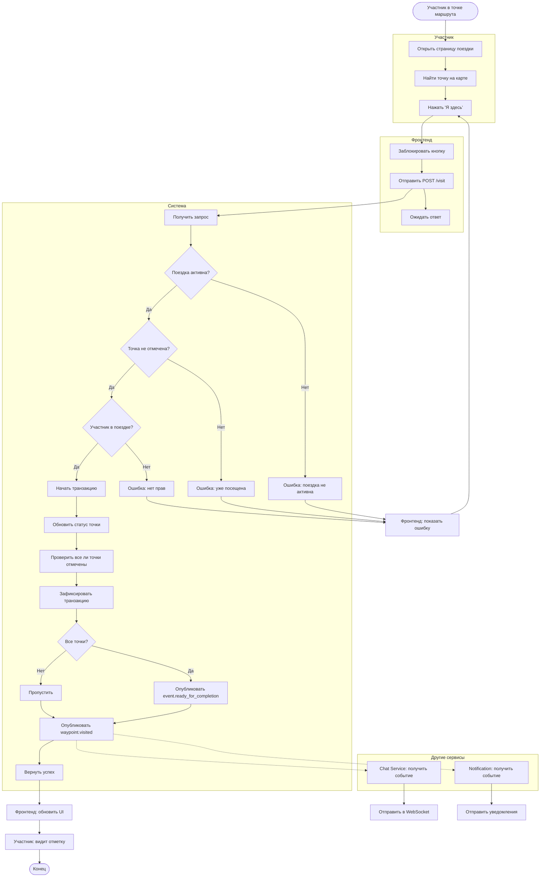

# 1. Поведенческие требования

## Требования к последовательности шагов и реакции на события

| ID | Требование | Критерий проверки | Источник |
|----|-----------|-------------------|----------|
| **BR-01** | Система должна обеспечивать создание маршрута-шаблона с последовательным заполнением обязательных полей | При попытке отправки на модерацию без обязательных полей возникает ошибка валидации | UC-1 (Создать маршрут) |
| **BR-02** | При отправке маршрута на модерацию система должна уведомлять всех доступных модераторов | Модератор получает уведомление в течение 1 минуты после отправки | UC-2 (Опубликовать маршрут) |
| **BR-03** | Решение модератора (одобрение/отклонение) должно обрабатываться в течение 24 часов | По истечении 24 часов система отправляет напоминание | Регламент модерации |
| **BR-04** | Пользователь должен получать уведомление о результате модерации с указанием причины отказа (если есть) | После решения модератора пользователь получает email и in-app уведомление | UC-3 (Модерировать контент) |
| **BR-05** | При создании поездки система должна проверять, что дата старта находится в будущем | Попытка создать поездку с прошедшей датой отклоняется с ошибкой | UC-4 (Запланировать поездку) |
| **BR-06** | Приглашения участникам должны отправляться сразу после создания групповой поездки | Приглашённые пользователи получают email в течение 1 минуты | UC-5 (Пригласить в поездку) |
| **BR-07** | Пользователь может присоединиться к поездке только при статусе "Запланирована" | При попытке присоединиться к активной или завершённой поездке возникает ошибка | UC-6 (Присоединиться к поездке) |
| **BR-08** | Отметка точки маршрута должна фиксировать фактическое время посещения | После отметки в системе сохраняется actual_time = now() | UC-7 (Отметить посещение) |
| **BR-09** | Точка маршрута не может быть отмечена повторно | При повторной попытке отметки возникает ошибка | UC-7 (Отметить посещение) |
| **BR-10** | Поездка может быть завершена только после отметки всех точек или по решению организатора | Система проверяет статус всех точек перед завершением | UC-9 (Завершить поездку) |
| **BR-11** | При завершении поездки система автоматически создаёт фотоотчёт из загруженных медиа | После завершения появляется страница с галереей фотографий | UC-9 (Завершить поездку) |
| **BR-12** | Все изменения статусов сущностей должны фиксироваться в аудите с указанием пользователя и времени | В таблице аудита появляется запись о каждом переходе | Требование к наблюдаемости |
| **BR-13** | При параллельном редактировании одной сущности должна использоваться оптимистическая блокировка | При конфликте версий пользователь получает ошибку 409 Conflict | Требование к целостности |
| **BR-14** | Операции создания и обновления должны быть идемпотентными | Повторный запрос с тем же idempotency-key не создаёт дубликат | Требование к надёжности |
| **BR-15** | При недоступности внешних сервисов (email, Kafka) система должна сохранять запросы в очередь для повторной отправки | После восстановления сервиса отложенные операции выполняются | Требование к отказоустойчивости |

# 2. Выбор сценариев для моделирования поведения

## Сценарий 1: **Публикация маршрута-шаблона**
- **Границы:** От момента отправки на модерацию до получения результата пользователем
- **Ожидаемые эффекты:**
  - Маршрут меняет статусы: `Черновик` → `На модерации` → `Опубликован`/`Черновик`
  - Модератор получает уведомление
  - Пользователь получает уведомление о результате
  - События фиксируются в аудите
- **Внешние интеграции:** Email-сервис (уведомления), Kafka (события)
- **Возможные сбои:**
  - Недоступность email-сервиса
  - Конфликт версий при параллельной модерации
  - Тайм-аут модерации (>24ч)

## Сценарий 2: **Проведение групповой поездки**
- **Границы:** От автоматического старта поездки до завершения и создания фотоотчёта
- **Ожидаемые эффекты:**
  - Поездка меняет статусы: `Запланирована` → `Активна` → `Завершена`
  - Участники отмечают точки, меняется статус точек
  - Загружаются медиафайлы
  - Создаётся фотоотчёт
- **Внешние интеграции:** Email (уведомления), MinIO (медиа), Kafka (события)
- **Возможные сбои:**
  - Недоступность MinIO при загрузке фото
  - Конфликт при одновременной отметке последней точки
  - Потеря соединения WebSocket в чате

# 3. Определение набора диаграмм для каждого сценария

## Сценарий 1: Публикация маршрута

| Диаграмма | Назначение | Какие вопросы отвечает |
|-----------|-----------|------------------------|
| **Диаграмма деятельности** | Поток действий с распределением по ролям | Кто что делает? Какие ветвления и исключения? |
| **Диаграмма последовательности** | Взаимодействие компонентов | Какие сообщения передаются между сервисами? |
| **Диаграмма состояний (Route)** | Жизненный цикл маршрута | Какие статусы проходит маршрут? Какие переходы допустимы? |
| **Диаграмма коммуникации** | Структура взаимодействия | Как связаны участники в пространстве? |

## Сценарий 2: Проведение групповой поездки

| Диаграмма | Назначение | Какие вопросы отвечает |
|-----------|-----------|------------------------|
| **Диаграмма деятельности** | Процесс с параллельными ветвями | Как синхронизируются действия участников? |
| **Диаграмма последовательности** | Взаимодействие при отметке точки | Кто инициирует? Какие сервисы участвуют? |
| **Диаграмма состояний (Event)** | Жизненный цикл поездки | Какие статусы и переходы? |
| **Диаграмма состояний (Task)** | Жизненный цикл задач | Как задачи связаны с поездкой? |
| **Диаграмма взаимодействия (WebSocket)** | Реальное время | Как работает чат? |

**Источник истины:** Диаграмма состояний для статусов, диаграмма деятельности для процессов, диаграмма последовательности для контрактов API.

# 4. Диаграммы взаимодействия для сценариев

## Сценарий 1: Публикация маршрута (Диаграмма последовательности)



## Сценарий 2: Отметка точки в активной поездке (Диаграмма последовательности)



# 5. Диаграммы деятельности для сценариев

*(Использованы диаграммы из Практической работы №8 с исправленным синтаксисом)*

## Сценарий 1: Публикация маршрута



## Сценарий 2: Проведение групповой поездки (ключевой фрагмент - отметка точки)



# 6. Сопоставление с диаграммами состояний

## Проверка соответствия для Сценария 1

| Шаг сценария | Изменение статуса | Допустимо по диаграмме состояний? |
|--------------|-------------------|-----------------------------------|
| Отправка на модерацию | Черновик → На модерации | ✓ Да |
| Одобрение модератором | На модерации → Опубликован | ✓ Да |
| Отклонение модератором | На модерации → Черновик | ✓ Да |
| Редактирование после отказа | Черновик → Черновик | ✓ Да (самопереход) |
| Удаление опубликованного | Опубликован → Удалён | ✓ Да |

## Проверка соответствия для Сценария 2

| Шаг сценария | Изменение статуса | Допустимо по диаграмме состояний? |
|--------------|-------------------|-----------------------------------|
| Автоматический старт | Запланирована → Активна | ✓ Да |
| Отметка точки | pending → visited (для точки) | ✓ Да |
| Приостановка поездки | Активна → Приостановлена | ✓ Да |
| Возобновление | Приостановлена → Активна | ✓ Да |
| Завершение после всех точек | Активна → Завершена | ✓ Да |
| Преждевременное завершение | Активна → Завершена | ⚠ Требуется подтверждение |

**Выявленное несоответствие:** В диаграмме состояний нет явного разрешения на преждевременное завершение поездки организатором. **Решение:** Добавить переход "Принудительное завершение" с условием "организатор подтвердил".

# 7. Требования к обработке ошибок и компенсации

## Типы сбоев и обработка

| Тип сбоя | Сценарий | Обработка | Компенсационные действия |
|----------|----------|-----------|-------------------------|
| **Недоступность БД** | При сохранении данных | Retry (3 раза) с экспоненциальной задержкой, затем ошибка пользователю | Откат локальных изменений, возврат идемпотентного ключа |
| **Конфликт версий** | Параллельное редактирование | 409 Conflict с информацией о конфликте | Пользователь получает актуальные данные и повторяет действие |
| **Сбой интеграции (email)** | Отправка уведомлений | Сохранение в очередь, повтор через 5/15/60 мин | - |
| **Сбой интеграции (MinIO)** | Загрузка фото | Retry 3 раза, затем ошибка | Удаление временных файлов |
| **Тайм-аут модерации** | Маршрут >24ч на модерации | Напоминание модератору, эскалация через 48ч | - |
| **Потеря WebSocket** | Чат поездки | Автоматическое переподключение с эксп. задержкой | Синхронизация пропущенных сообщений при переподключении |
| **Частичное выполнение** | Отметка точки + уведомления | Транзакция: либо всё, либо ничего | При сбое после отметки, но до уведомления — уведомления отправляются позже |

## Идемпотентность

| Операция | Идемпотентный ключ | Механизм |
|----------|-------------------|----------|
| Создание маршрута | `idempotency-key` (заголовок) | Проверка в кэше, возврат ранее созданного ID |
| Отметка точки | `event_id + waypoint_id + user_id` | Проверка статуса, повторная отметка возвращает ошибку |
| Загрузка фото | `checksum файла + event_id` | Дедупликация по хешу |
| Отправка сообщения | `message_id` (клиентский) | Сохранение ID обработанных сообщений |

# 8. Трассируемость требований, диаграмм и тестов

| Требование | Диаграмма деятельности | Диаграмма последовательности | Диаграмма состояний | Тест-кейсы |
|------------|------------------------|------------------------------|---------------------|------------|
| BR-01: Валидация маршрута | П1: шаг S1-S3 | С1: сообщения 3-5 | Route: Черновик | TC1, TC2, TC3 |
| BR-02: Уведомление модератора | П1: шаг S5 | С1: сообщения 13-15 | - | TC4 |
| BR-03: Тайм-аут модерации | П1: доп. путь | - | - | TC5 |
| BR-04: Уведомление пользователя | П1: шаг S10 | С1: сообщения 28-34 | - | TC6 |
| BR-05: Проверка даты поездки | - | - | Event: Запланирована | TC7 |
| BR-06: Отправка приглашений | - | - | - | TC8 |
| BR-07: Присоединение к поездке | - | - | Event: Запланирована | TC9 |
| BR-08: Фиксация времени отметки | П2: шаг S9 | С2: сообщения 12-14 | Waypoint: visited | TC10 |
| BR-09: Запрет повторной отметки | П2: шаг S4-S5 | С2: проверка на шаге 8 | Waypoint: visited → (запрет) | TC11 |
| BR-10: Завершение после всех точек | П2: шаг S10-S13 | С2: сообщения 16-18 | Event: Активна → Завершена | TC12 |
| BR-11: Создание фотоотчёта | - | - | - | TC13 |
| BR-12: Аудит изменений | П1: S6, S13; П2: S15 | С1: сообщение 11; С2: сообщение 19 | Все переходы | TC14 |
| BR-13: Оптимистическая блокировка | - | С2: сообщение 12 (WITH version) | - | TC15 |
| BR-14: Идемпотентность | - | - | - | TC16 |
| BR-15: Очереди при сбоях | - | - | - | TC17 |

# 9. Наблюдаемость поведения и диагностика

## События для аудита и логирования

| Событие | Уровень логирования | Данные для аудита | Метрика |
|---------|---------------------|-------------------|---------|
| `route.created` | INFO | user_id, route_id, timestamp | Счётчик созданных |
| `route.submitted` | INFO | user_id, route_id, timestamp | Время до модерации |
| `route.approved` | INFO | moderator_id, route_id, comment | % одобрений |
| `route.rejected` | INFO | moderator_id, route_id, reason | % отказов |
| `event.created` | INFO | user_id, event_id, route_id | Счётчик поездок |
| `event.started` | INFO | event_id, actual_start | Время старта |
| `waypoint.visited` | INFO | user_id, event_id, waypoint_id, time | Прогресс |
| `event.completed` | INFO | event_id, duration | Длительность |
| `media.uploaded` | INFO | user_id, event_id, size | Объём данных |
| `error.validation` | WARN | user_id, field, value | % ошибок ввода |
| `error.concurrency` | ERROR | entity_type, entity_id, version | Частота конфликтов |
| `error.integration` | ERROR | service, endpoint, retry_count | Надёжность интеграций |

## Метрики деградации поведения

| Метрика | Норма | Тревога | Действие |
|---------|-------|---------|----------|
| Время модерации > 24ч | <5% | >20% | Проверить загрузку модераторов |
| % конфликтов версий | <1% | >5% | Оптимизировать блокировки |
| % ошибок валидации | <10% | >30% | Улучшить UI/подсказки |
| Время ответа API (p95) | <200ms | >500ms | Масштабировать сервисы |
| Количество ретраев интеграций | <1% | >5% | Проверить внешние сервисы |
| Активные WebSocket соединения | - | Резкое падение | Проверить Chat Service |

## Диагностика по логам

**Проблема:** Пользователь сообщает, что не получил уведомление о публикации маршрута

**Поиск причины:**
1. Найти `route_id` по логам пользователя
2. Проверить событие `route.approved` в аудите
3. Найти событие `notification.sent` с этим `route_id`
4. Если есть → проверить Email Service
5. Если нет → проверить Kafka consumer Notification Service
6. Найти ошибки интеграции в логах Notification Service

**Пример запроса к логам (ELK/Loki):**
```
{service="notification-service"} |~ "route.approved.*route_id=123"
{service="email-service"} |~ "route_id=123"
```

# 10. Итоговый пакет результатов

## Состав пакета

| Компонент | Описание | Формат |
|-----------|----------|--------|
| **Поведенческие требования** | 15 требований с ID и критериями | Таблица |
| **Сценарии** | 2 критических сценария с границами | Текстовое описание |
| **Диаграммы последовательности** | 2 диаграммы (публикация, отметка точки) | Mermaid |
| **Диаграммы деятельности** | 2 диаграммы (процессы) | Mermaid |
| **Диаграммы состояний** | 3 диаграммы (Route, Event, Task) | Из ПР7 |
| **Таблица трассируемости** | Связь требований, диаграмм, тестов | Таблица |
| **Требования к ошибкам** | Типы сбоев, идемпотентность, компенсация | Таблица |
| **Наблюдаемость** | События аудита, метрики, диагностика | Таблица + описание |
| **Тест-кейсы** | 17 тестов на все требования | Таблица |

